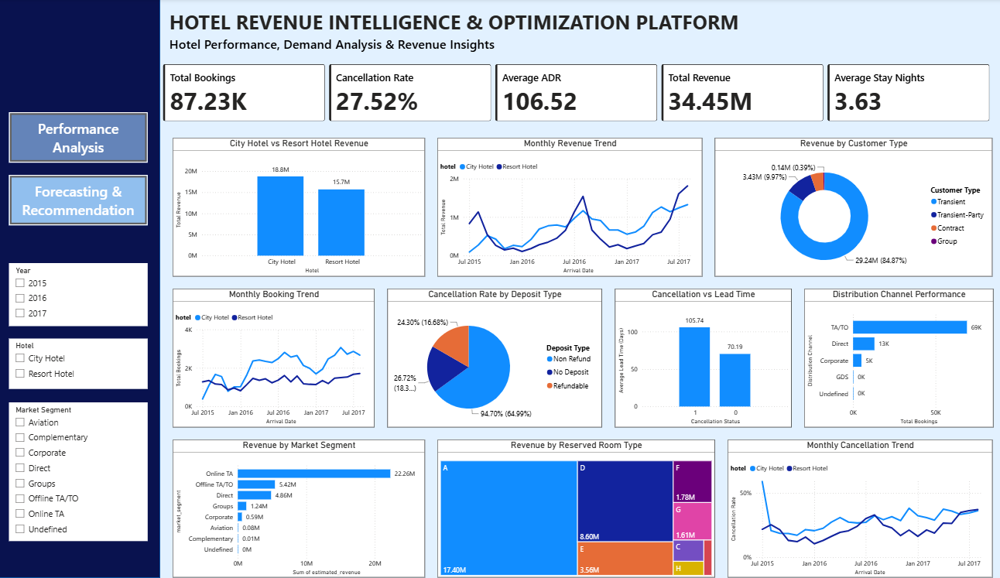
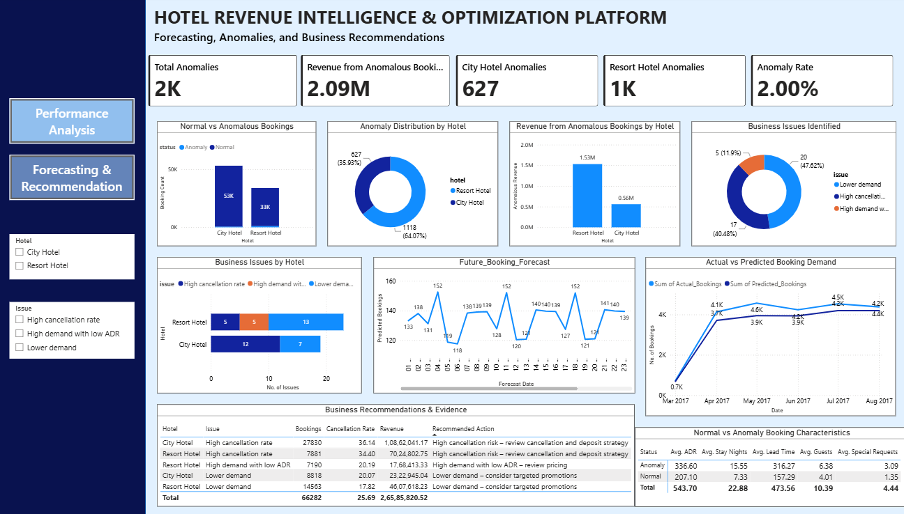

# Hotel Demand & Revenue Intelligence

End-to-end hotel booking analytics project combining Python, SQL, machine learning, demand forecasting and Power BI.

## Project purpose

Analyze historical hotel booking records to understand booking patterns, cancellations and customer behavior; identify unusual booking records; forecast daily demand; and present results in an interactive Power BI dashboard.

## Repository structure

```text
hotel-demand-forecasting/
├── dashboard/
│   ├── hotel_demand_revenue_dashboard.pbix
│   └── screenshots/
├── data/
│   ├── raw/                 # Add the original CSV dataset here
│   └── processed/           # Add/generated cleaned CSV files here
├── docs/
├── notebooks/
│   ├── 01_revenue_and_booking_analysis.ipynb
│   ├── 02_eda_and_data_cleaning.ipynb
│   ├── 03_prepare_data_for_sql.ipynb
│   ├── 04_anomaly_detection.ipynb
│   ├── 05_demand_forecasting.ipynb
│   └── 06_business_recommendations.ipynb
├── results/
│   ├── anomalies/
│   └── forecasts/
├── sql/
│   └── hotel_business_analysis.sql
├── requirements.txt
└── README.md
```

## Workflow

1. **Data preparation and EDA** — inspect, clean and transform booking data with Pandas.
2. **Booking and revenue analysis** — calculate hotel, cancellation, customer-segment and channel metrics.
3. **SQL analysis** — query daily/monthly demand, hotel performance, market segments and distribution channels.
4. **Anomaly detection** — apply Isolation Forest to flag unusual booking patterns.
5. **Demand forecasting** — compare a 7-day moving average, SARIMA and Random Forest approaches.
6. **Business recommendations** — translate findings into operational and commercial actions.
7. **Power BI** — explore historical performance and demand forecasts in a two-page dashboard.

## Technology stack

Python, Pandas, NumPy, Matplotlib, Seaborn (if used by a notebook), Scikit-learn, Statsmodels, SQL and Power BI (Power Query / DAX).

## Getting started

### 1. Create an environment and install dependencies

```bash
python -m venv .venv
# Windows
.venv\\Scripts\\activate
# macOS/Linux
source .venv/bin/activate

pip install -r requirements.txt
```

### 2. Add the dataset

The uploaded project archive did **not** contain the CSV source datasets. Add the permitted dataset files to:

- `data/raw/hotel_bookings.csv` — original data used by the cleaning notebook.
- `data/processed/hotel_bookings_cleaned.csv` — cleaned data expected by the downstream notebooks.

The notebooks use project-relative paths instead of the original author's Google Drive path. Run notebooks from the repository root. Some notebook steps may require column names or generated intermediate files from earlier steps.

### 3. Run notebooks in order

Open the notebooks in Jupyter or Google Colab and execute them in numerical order. Review each notebook's inputs and outputs before running later stages.

### 4. Open the Power BI report

Open `dashboard/hotel_demand_revenue_dashboard.pbix` with Power BI Desktop. The report may need its data source path updated to the local processed data on your computer.

## Dashboard previews

### Page 1 — Hotel performance and booking analytics



### Page 2 — Demand forecasting and business recommendations



## Reported results

The source project README reports the following results (reproduced here as project-reported figures, not independently re-run during repository organization):

- Approximately 87,230 hotel booking records analyzed.
- 1,745 anomalous booking records identified.
- City Hotel: SARIMA reported as the best model (MAE 16.37, RMSE 21.05).
- Resort Hotel: Random Forest reported as the best model (MAE 11.07, RMSE 15.38).
- A 30-day forecast was reported for 1–30 September 2017.

## Important notes before public release

- The supplied archive did not include the CSV dataset. Check the dataset's license and redistribution terms before adding it.
- The archive includes a Power BI `.pbix` file. Check that it does not embed private, licensed or confidential data before publishing.
- The original README identifies **Pranjali Sus** as the author. This reorganization does not establish ownership or permission to republish the original notebooks, SQL, report or dashboard. Preserve appropriate attribution and obtain permission or verify the repository's license before publishing a public fork or presenting the work as your own.
- No `LICENSE` file was present in the supplied archive. Do not assume that the source files are open for reuse.
- The source documentation describes revenue analysis, but verify the dataset fields and Power BI measures before making claims about actual revenue calculations.

## Original source attribution

The supplied project README names **Pranjali Sus** as its author. Retain this attribution unless you have permission and a valid basis to change it.

